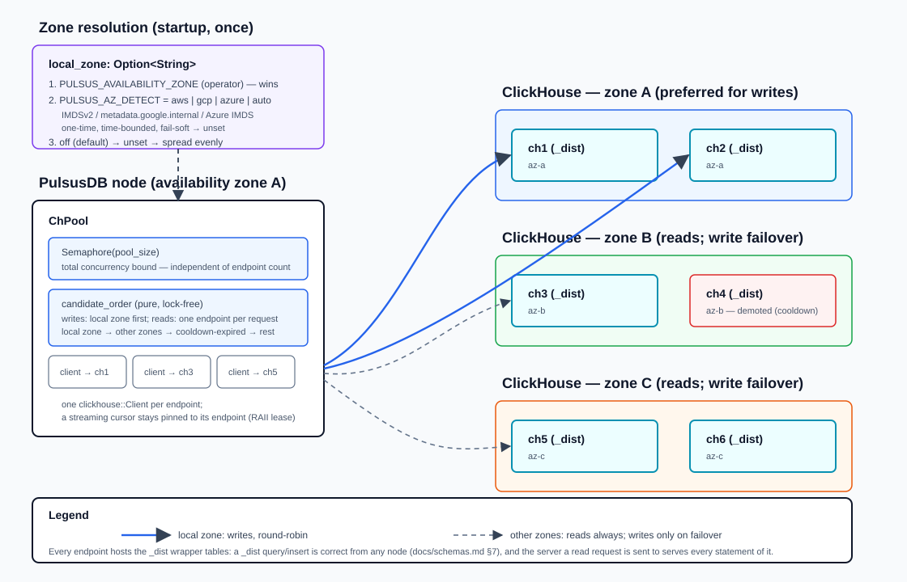

# Connection spreading & availability-zone affinity

> **Stale on landing placement and on the metrics token.** On a cluster every landing table is
> written through its wrapper, `<landing table><PULSUS_DIST_SUFFIX>` (`log_landing_dist` at the
> default suffix): `log_landing` and `trace_landing` keyed on `cityHash64(received_ms)`, so a log or
> trace push and the writer's resends of it reach one shard; `metric_landing` keyed on
> `cityHash64(fingerprint)`, so a metrics push's content insert is one block per shard its series
> select, its descriptor insert one more block on fingerprint `0`'s shard, and all of a series' rows sit
> on the shard every metrics table's wrapper names. A metrics push's samples, series and exemplars
> carry an `insert_deduplication_token` derived from its tenant and content; its descriptors go in
> an insert of their own under a minted token. Every landing insert pins
> `distributed_foreground_insert`, `insert_shard_id`, `skip_unavailable_shards`,
> `prefer_localhost_replica` and `timeout_overflow_mode`. Passages below that say a landing table has
> no wrapper, that a push is placed by the connection, or that a landing token is minted for a
> metrics block, are out of date. Current behaviour: `schema/schema.sql`,
> `QuerySettings::landing_insert` (`crates/pulsus-clickhouse/src/settings.rs`), `metric_landing_token`
> (`crates/pulsus-write/src/writer/push_dedup.rs`), and `docs/configuration.md`'s
> connection-spreading section.

PulsusDB can spread its ClickHouse connections across multiple endpoints and
prefer the ones in its own cloud availability zone (AZ), failing over to other
zones the moment a local endpoint stops answering. This cuts cross-AZ network
cost on the common path while keeping the deployment available when a zone or
node degrades.

This is a PulsusDB-side, connection-level concern. It does **not** change any
SQL, pushdown, granule pruning, projection choice, or `_dist` fan-out — a
`_dist` (Distributed) query or insert is correct from **any** cluster node
(docs/schemas.md §7), so spreading changes *which node coordinates the identical query*. The SQL does not change, but the coordinator decides which replicas serve the read, and a replica still receiving a block answers without it. That is why every statement of one read request goes to one server (see How the pool works).

**One write is placed by the endpoint it was sent to**, and it is still correct
from any of them: a logs or metrics push inserts into `log_landing` /
`metric_landing`, which have no `_dist` wrapper, so the block and every row the
views derive from it land on the shard that took the request (issue #603,
docs/schemas.md §7). Spreading therefore spreads those rows, which is what the
sharding key used to decide. No read's answer depends on it — the logs and
metrics reads merge across shards — and the endpoint list requirement below is
unchanged, every endpoint still being a cluster member.



## Configuration

These settings drive it (docs/configuration.md §2 and §4):

| Setting | Purpose |
|---------|---------|
| `CLICKHOUSE_SERVERS` (`clickhouse.servers`) | the endpoint list — `host[:port][=zone]`, comma-separated in the env form |
| `PULSUS_AVAILABILITY_ZONE` (`availability_zone`) | this node's own zone (operator-supplied) |
| `PULSUS_AZ_DETECT` (`az_detect`) | auto-detect this node's zone from cloud metadata when not set explicitly |
| `PULSUS_READ_SPREAD` (`read_spread`) | `all` (default): each read request goes to any one endpoint, taking turns; `zone`: to one in this node's zone first, as writes do |

Backward compatible: with none of these set, PulsusDB dials the single
`CLICKHOUSE_SERVER`/`CLICKHOUSE_HTTP_PORT` endpoint exactly as before.

Example (6-node cluster, 2 per zone; this node in `az-a`):

```
CLICKHOUSE_SERVERS=ch1:8123=az-a,ch2:8123=az-a,ch3:8123=az-b,ch4:8123=az-b,ch5:8123=az-c,ch6:8123=az-c
PULSUS_AVAILABILITY_ZONE=az-a
```

YAML (use this for IPv6 literals, which the flat env form can't express):

```yaml
availability_zone: az-a
clickhouse:
  http_port: 8123          # per-entry fallback when an entry omits its own port
  servers:
    - { host: ch1, http_port: 8123, zone: az-a }
    - { host: ch2, zone: az-a }        # http_port inherits clickhouse.http_port
    - { host: ch3, http_port: 8123, zone: az-b }
    - { host: ch4, http_port: 8123, zone: az-b }
```

**Topology requirement:** every listed endpoint must be a cluster member that
hosts the `_dist` wrapper tables (see above).

## How the pool works

The connection pool (`crates/pulsus-clickhouse/src/pool.rs`) holds **one
`clickhouse::Client` per distinct endpoint** behind a **single semaphore**.
That semaphore bounds *total* concurrent requests to `PULSUS_CH_POOL_SIZE` —
it is not multiplied by the endpoint count, and the RAII lease discipline is
unchanged (a streaming cursor owns exactly one permit and one endpoint for its
whole lifetime, released on drop).

A **write** lease (every insert, `execute`, `ping`) chooses an endpoint with a pure, lock-free policy (`candidate_order`): endpoints in this node's zone lead (round-robin among them), then the other healthy endpoints (round-robin), then demoted endpoints whose cooldown has expired, then the rest. A **read request** is bound to one endpoint when its client is built: the first of that same order, with no zone leading under `read_spread: all` and this node's zone under `zone`, from a rotation of its own. Every read of that client is leased on that endpoint, whatever happens to its health meanwhile, so a request never moves between endpoints while it runs. If a read reports a server failure, the endpoint is demoted and the request is marked. When it ends, it runs once more with a new client and so a new endpoint, and only the run whose answer is used may update a cache. On the healthy path this is a few atomic loads, a modulo, and a zone compare — **no ping and no extra round-trip.**

## Failover

Selection carries no active health probing on the hot path. Instead, a
**transport-class failure** on a real query — a connection/timeout/IO error or
a retryable ClickHouse server code, never a bad-SQL/decode/logic error —
demotes that endpoint. Health is published as lock-free mirror atomics for the
hot path (`get()`'s healthy+fresh path never locks anything), backed by a tiny
non-async transition lock — never held across an `.await`, never in `Drop` —
that makes every state change (a demotion, a promotion, or a probe outcome)
one atomic critical section. The next `get()` skips a demoted endpoint until a
short cooldown elapses, then re-admits it as a probe candidate; a successful
probe re-promotes it immediately. This matches "immediately start using other
AZs on disconnect" with zero healthy-path overhead: at most one failed request
per newly-dead endpoint.

A read request whose endpoint fails is not continued elsewhere: its partial results are dropped and the whole request runs once more on another healthy endpoint, and a live tail repeats the failed poll. A read timeout is the request's own deadline: it demotes nothing and is not run again.

Startup uses "ping-any": the pool starts if at least one endpoint answers, so
a partially-degraded cluster is still serviceable.

## Recovery: background re-probe

Real traffic alone cannot rediscover a recovered endpoint once any other
endpoint is healthy — `candidate_order` ranks a demoted-but-cooldown-expired
endpoint below every healthy one, so `get()` never reaches it while the pool
has a healthy candidate to hand out instead. A background task closes that
gap: every 5 seconds it scans for demoted endpoints whose cooldown has
expired and re-pings **only those**, each capped at a 2-second timeout.
Promotion requires 2 **consecutive** successful pings (hysteresis) — a single
lucky ping does not resurrect a flapping endpoint, and any probe failure
resets the streak and restarts the cooldown.

Each probe borrows one permit from the pool's single concurrency semaphore —
the same budget every real request draws from — via a **non-queuing**
attempt: it never enters the semaphore's FIFO wait queue, so it can only ever
use capacity nobody else wants at that instant. If the pool is fully leased
(or has real callers already queued), the rest of that pass is deferred to
the next 5-second tick rather than making a request wait behind a health
probe. Concurrent transitions (a real query demoting the same endpoint, or
`get()`'s own single-success emergency/staleness probe) are reconciled via a
per-endpoint generation counter: whichever transition lands first wins, and a
stale probe outcome is discarded entirely rather than clobbering it.

The background task is spawned once the connection pool is established and is
stopped (aborted and joined) as part of the same graceful-shutdown sequence as
the schema-rotation and label-cache-refresh tasks, so pool teardown never
races an in-flight probe.

## Availability-zone auto-detection

`local_zone` is a single `Option<String>` threaded through the pool. How it is
populated at startup is isolated in `crates/pulsus-server/src/azdetect.rs`:

1. an explicitly-set `PULSUS_AVAILABILITY_ZONE` always wins;
2. otherwise, if `PULSUS_AZ_DETECT` names a cloud (or `auto`), the zone is read
   once from the provider's instance-metadata service:
   - **AWS** — IMDSv2 (token-required `PUT /latest/api/token`, then
     `GET /latest/meta-data/placement/availability-zone`; IMDSv1 is not used,
     for SSRF hardening);
   - **GCP** — `GET /computeMetadata/v1/instance/zone` with
     `Metadata-Flavor: Google` (the trailing path segment is the zone);
   - **Azure** — `GET /metadata/instance/compute/zone?...&format=text` with
     `Metadata: true`;
3. otherwise (`off`, the default) the zone stays unset → even spreading.

Detection is a one-time startup probe, individually time-bounded, with proxies
disabled (a configured HTTP proxy must never intercept a link-local metadata
call), and **fail-soft**: any failure/timeout/miss leaves the zone unset
rather than blocking startup. The zone strings a provider returns (e.g.
`us-east-1a`, `us-central1-a`) must match the `=zone` labels given to
`CLICKHOUSE_SERVERS` for affinity to take effect.

The pool/selection/failover mechanics never see this module: auto-detection
only changes how the one `local_zone` field is filled, exactly as an
operator-supplied value would.
